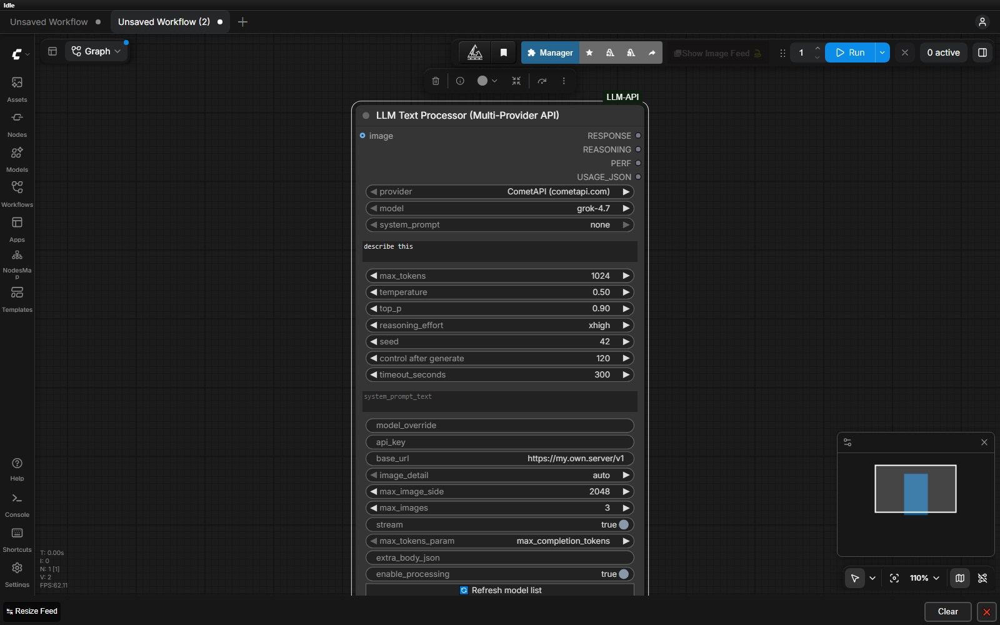

# ComfyUI LLM API (Multi-Provider)

One ComfyUI node that talks to **any OpenAI-compatible LLM gateway**. Pick the
provider from a dropdown — the model list and the reasoning levels follow it
automatically.

Originally built as the Grokified-specific node, generalised so the same
workflow can run on **CometAPI**, **Grokified**, **Coarena**, **Baza AI**,
**HowToFix ID**, **Cloudflare Workers AI**, **Crusoe Cloud**, **FastRouter**,
the local **Grok Build** proxy, or a **local server** without rewiring
anything.

```
provider ▾  CometAPI (cometapi.com)
model    ▾  grok-4.7
```



The status line under the widgets always shows which gateway is active, how many
chat models it advertises, and which environment variable the key is read from.

---

## Why

`ComfyUI-LLM-text-processor` runs a local llama.cpp model.
`ComfyUI-Grokified-API` talks to one cloud gateway.
This pack keeps the same four outputs but lets you switch gateways per node, so
you can A/B two providers, fall back when one account runs dry, or point at a
self-hosted server — with no workflow changes.

---

## Install

```bash
cd ComfyUI/custom_nodes
git clone https://github.com/CraftBlack/ComfyUI-LLM-API.git
```

Restart ComfyUI (or hit **R** in the browser to reload the frontend), then look
under **LLM/API** → *LLM Text Processor (Multi-Provider API)*.

`requirements.txt` lists `requests`, `Pillow` and `numpy` — all three already
ship with ComfyUI, so there is normally nothing to install.

---

## API keys

A key is resolved in this order:

1. the node's **`api_key`** widget (advanced),
2. the provider's **environment variable**.

| Provider | Environment variable | Where to get one |
|---|---|---|
| CometAPI | `COMETAPI_API_KEY` | <https://cometapi.com> → API keys |
| Grokified | `GROKIFIED_API_KEY` | <https://grokified.com> |
| Coarena | `COARENA_API_KEY` | <https://coarena.ai/account/api/keys> |
| Baza AI | `BAZAAI_API_KEY` | your Baza AI account |
| HowToFix ID | `HOWTOFIX_API_KEY` | your HowToFix ID account |
| Cloudflare Workers AI | `CLOUDFLARE_API_TOKEN` | your Cloudflare API token; also set `CLOUDFLARE_ACCOUNT_ID` |
| Crusoe | `CRUSOE_API_KEY` | your Crusoe Cloud account |
| FastRouter | `FASTROUTER_API_KEY` | your FastRouter account |
| Grok Build | `GROK_API_KEY` | required; the key is in `kunci_api_grok.txt` on the proxy machine |
| Custom | `LLM_API_KEY` | optional; local servers usually need none |

Grok Build always requires the key (the Tailscale proxy protects every endpoint,
including `/health`). Custom may run without one: leave `api_key` empty and the
node sends no `Authorization` header at all.

Cloudflare Workers AI also needs `CLOUDFLARE_ACCOUNT_ID` to build the endpoint
URL; the committed default is redacted.

The real Grok Build hostname is **redacted** in this repo. Set `GROK_BUILD_URL`
(e.g. `https://<your-tailnet-host>:8443`) or the node's `base_url` to your
Funnel URL; the committed default points at `redacted.tail341768.ts.net`.

Windows (persists for the user account):

```powershell
[Environment]::SetEnvironmentVariable("COMETAPI_API_KEY", "sk-...", "User")
[Environment]::SetEnvironmentVariable("COARENA_API_KEY", "coa_...", "User")
[Environment]::SetEnvironmentVariable("BAZAAI_API_KEY", "ks_live_...", "User")
[Environment]::SetEnvironmentVariable("HOWTOFIX_API_KEY", "sk-...", "User")
[Environment]::SetEnvironmentVariable("CLOUDFLARE_ACCOUNT_ID", "<account-id>", "User")
[Environment]::SetEnvironmentVariable("CLOUDFLARE_API_TOKEN", "cfut_...", "User")
[Environment]::SetEnvironmentVariable("CRUSOE_API_KEY", "<crusoe-key>", "User")
[Environment]::SetEnvironmentVariable("FASTROUTER_API_KEY", "sk-v1-...", "User")
# Grok Build (Tailscale): copy the key from kunci_api_grok.txt
[Environment]::SetEnvironmentVariable("GROK_API_KEY", "<key-dari-kunci_api_grok.txt>", "User")
[Environment]::SetEnvironmentVariable("GROK_BUILD_URL", "https://<your-tailnet-host>:8443", "User")
```

Linux / macOS / WSL:

```bash
echo 'export COMETAPI_API_KEY=sk-...' >> ~/.bashrc && source ~/.bashrc
```

**Restart ComfyUI afterwards** — a running process keeps the environment it was
started with. Prefer the widget if you would rather not restart, but note that
widget values are stored in the workflow `.json` in plain text.

---

## Nodes

| Node | What it does |
|---|---|
| **LLM Text Processor (Multi-Provider API)** | Calls `/chat/completions` and returns the answer, the reasoning trace, a perf line and raw usage JSON. Optional `IMAGE` input for vision models. |
| **LLM API Model List** | Calls `GET /models` on the selected provider and returns the chat-capable model ids, one per line. Handy for discovering what a gateway offers today. |

Outputs of the main node deliberately match `ComfyUI-LLM-text-processor` and
`ComfyUI-Grokified-API`:

| # | Name | Contents |
|---|---|---|
| 0 | `RESPONSE` | Final answer, reasoning stripped out |
| 1 | `REASONING` | The model's reasoning trace (empty when it exposes none) |
| 2 | `PERF` | e.g. `CometAPI \| grok-4.7 \| 1248 in / 58 out (reasoning 56) \| 2.10s stream` |
| 3 | `USAGE_JSON` | Provider, model, base URL, token counts (incl. `reasoning_tokens` and `reasoning_chars`), latency, notes |

---

## Providers

| Provider | Base URL | Default model | Catalogue | Reasoning | Vision | Streaming |
|---|---|---|---|---|---|---|
| CometAPI | `https://api.cometapi.com/v1` | `grok-4.7` | 472 ids, **15** chat | `minimal` … `max` | yes | yes |
| Grokified | `https://api.grokified.com/v1` | `grok-4.7` | account-dependent | `low` … `xhigh` | yes | yes |
| Coarena | `https://coarena.ai/api/v1` | `grok-4-7` | 18 ids, all chat | `minimal` … `max` | yes | usage via `stream_options` |
| Baza AI | `https://api.baza-ai.org/v1` | `grok-4.7` | 44 ids | `minimal` … `max` | yes | reasoning + usage included |
| HowToFix ID | `https://api.howtofix.id/v1` | `grok-4.7` | 12 ids | `minimal` … `xhigh` | yes | reasoning + usage included |
| Cloudflare | `https://api.cloudflare.com/client/v4/accounts/<redacted>/ai/v1` | `@cf/google/gemma-4-26b-a4b-it` | 1 id (static; `/v1/models` 405) | `low` … `max` | yes | reasoning + usage included |
| Grok Build | `https://<redacted>.tail341768.ts.net:8443/v1` | `grok-4.7` | 1 id | `minimal` … `xhigh` | yes (≥512 px) | usage via `stream_options` |
| Crusoe | `https://api.inference.crusoecloud.com/v1` | `google/gemma-4-31b-it` | 9 ids | `minimal` … `max` | yes | usage included |
| FastRouter | `https://api.fastrouter.ai/api/v1` | `google/gemma-4-31b-it-ultra` | 292 ids → 206 chat | `minimal` … `max` | yes | reasoning + usage included |
| Custom | anything | `local-model` | whatever it serves | all | depends | depends |

Coarena's `/models` entry advertises the efforts `low` … `xhigh`, but live calls
also accept `minimal` and `max`; the node offers all of them. Baza AI reports the
served model id as `gcli/grok-4.7` and only exposes reasoning text in stream
deltas. Grok Build is exposed through Tailscale Funnel (`api_server_tailscale.py`,
local port 8010) and always requires the key from `kunci_api_grok.txt`; paste
that key into the node's `api_key` field or set `GROK_API_KEY`. Its hostname is
redacted here — set `GROK_BUILD_URL` (root URL, `/v1` is appended) or the node's
`base_url` to your real Funnel URL.

HowToFix ID is a distributor gateway (`group free`): it can be slow or bursty
(one stream took >2 minutes to first byte), caps only the visible answer, and
reports no `reasoning_tokens`. The node retries it twice instead of four times.

Cloudflare Workers AI needs `CLOUDFLARE_ACCOUNT_ID` for the URL and
`CLOUDFLARE_API_TOKEN` for auth; the committed account default is redacted.
`/v1/models` is not supported (405), so the combo uses a static gemma fallback —
type other `@cf/...` ids into `model_override`. Its token cap covers
reasoning+content together, and `usage` reports Cloudflare's `neurons` cost.

Crusoe returns `reasoning_tokens` at the top level of `usage` and streams usage
by default; `gemma-4-31b-it` is multimodal (262k context).

FastRouter is an OpenRouter-style aggregator: `/models` carries 292 ids and the
node filters to text-output chat models (`architecture.modality` contains
`->text`, which leaves 206). Usage includes `cost` in USD and the upstream
`provider`; reasoning arrives as `reasoning` / `reasoning_details`.

The node asks `GET /models` for the live list and keeps only the ids a
`/chat/completions` call can actually serve (CometAPI tags them
`supported_endpoint_types: ["openai-chat", ...]`). If the endpoint is
unreachable, a static fallback list is shown and the reason appears in the
node's status line.

---

## Parameters

### Provider & model

| Widget | Notes |
|---|---|
| `provider` | Switching it reloads `model` and `reasoning_effort`. |
| `model` | Live catalogue for the selected provider. |
| `model_override` | Type any id to bypass the dropdown — required for custom endpoints. |
| `base_url` | Empty = the provider's own URL. The frontend fills it in when you switch provider; a value you typed is never overwritten. |
| `api_key` | Empty = the provider's environment variable. |

### Batch API / fallback chain

`fallback_chain` is a plain text box on the node (empty by default — nothing is
pre-filled and no model list is injected); you type the endpoints yourself, and
the placeholder shows the column order. It
turns the node into a failover chain: the primary
`provider` / `model` / `base_url` / `api_key` is tried first, then every entry
below it in order, until one answers. A failing gateway — HTTP error, timeout,
missing key, unfunded account, empty 200 — just moves on to the next one. The
run only fails when every endpoint has failed, and the error then lists each
attempt.

One endpoint per line, `provider | model | base_url | api_key`. Only the
provider is required; `-` leaves a slot at its default:

```
crusoe | google/gemma-4-31b-it
fastrouter | google/gemma-4-31b-it-ultra
custom | my-model | https://my-host/v1 | $MY_API_KEY
```

- `provider` — an id or label from the table above (`custom`, `crusoe`, ...).
- `model` — empty = that provider's default model.
- `base_url` — empty = that provider's own URL. This is how you point `custom`
  at LM Studio, Ollama or vLLM.
- `api_key` — empty = the provider's environment variable. `$VAR`, `${VAR}`
  and `env:VAR` read the key from the environment at run time, so the secret
  never has to sit in the workflow JSON. This column is where extra keys go;
  the node's own `api_key` widget stays a single key for the selected provider.

To rotate keys on one provider and model, list it again with a different key:

```
cometapi | grok-4.7 | - | $COMETAPI_KEY_A
cometapi | grok-4.7 | - | $COMETAPI_KEY_B
```

Shorthand `crusoe, fastrouter, coarena` works too, and JSON is accepted when an
entry needs its own sampling overrides:

```json
[
  {"provider": "custom", "base_url": "http://127.0.0.1:1234/v1",
   "model": "local-model", "api_key": "$LOCAL_LLM_KEY"},
  {"provider": "crusoe", "model": "google/gemma-4-31b-it", "max_tokens": 2048,
   "reasoning_effort": "low"}
]
```

JSON keys: `provider`, `model`, `base_url`, `api_key`, `reasoning_effort`,
`max_tokens`, `temperature`, `top_p`, `seed`, `stream`, `timeout`.

Behaviour notes:

- The primary endpoint is always attempt #1. Listing it again in the chain is
  ignored only when provider, model, URL and effective key all match, so the
  same request is never sent twice; a different key keeps the entry (rotation).
- `PERF` gains `failover after N failed attempt(s)`, and `USAGE_JSON` gains
  `fallback_used` plus an `attempts` array (`provider`, `model`, `ok`,
  `elapsed_seconds`, `error`) when a chain is configured.
- With no chain the outputs are exactly what they were before.
- A real answer is never overridden by a later endpoint; a 200 with an empty
  response counts as a failure while a fallback remains.
- Each endpoint still runs its own `max_attempts` retries internally, so one
  503 does not immediately burn the whole chain. Use a per-entry `timeout` when
  a slow gateway must not stall the rest.
- The primary widget accepts any provider string, but a typo inside
  `fallback_chain` fails immediately with a config error that lists the valid
  ids.

### Generation

| Widget | Default | Notes |
|---|---|---|
| `prompt` | — | User message. Dynamic prompts supported. |
| `system_prompt` | `none` | Preset from `ComfyUI/models/LLM/prompts` (same folder as the local LLM node). |
| `system_prompt_text` | `""` | Inline system prompt; wins over the preset. |
| `max_tokens` | `4096` | Output cap, sent as `max_completion_tokens`. |
| `temperature` / `top_p` | `0.7` / `0.95` | Sampling. Reasoning models may ignore them. |
| `reasoning_effort` | `high` | `default` omits the field entirely. |
| `seed` | `1` | Sent when > 0. Doubles as ComfyUI's cache key — bump it to force a fresh call. |
| `timeout_seconds` | `300` | Per-request timeout. |

### Images

| Widget | Default | Notes |
|---|---|---|
| `image` | — | `IMAGE` input; a batch sends up to `max_images` frames. |
| `image_detail` | `auto` | Sent only to providers without `supports_detail: false`. |
| `max_image_side` | `2048` | Downscales larger images. `0` disables. |
| `max_images` | `3` | Batch cap. |

Images are inlined as `data:` URIs (PNG while it fits, then JPEG at falling
quality, then progressively scaled down) and stay under 18 MiB.

### Advanced

`stream` (on by default), `max_tokens_param`, `extra_body_json` (merged into the
request body — `{"stop": ["\n\n"]}`), `enable_processing` (off = forward the
prompt to `RESPONSE` without calling the API, for dry runs).

---

## Verified behaviour

Everything below was measured against the live endpoints, not copied from docs.
Reproduce with `tests/probe_*.py`.

<details>
<summary><b>CometAPI</b> — <code>grok-4.7</code>, 2026-11-06</summary>

| Fact | Evidence |
|---|---|
| `grok-4.7` exists | present in the 472-id `/models` response |
| Only 15 of 472 ids are chat models | filtered on `supported_endpoint_types` containing `openai-chat` |
| `reasoning_effort` is honoured | `reasoning_tokens` scaled 166 → 1033 across `low` … `xhigh` |
| `minimal` and `max` are accepted | HTTP 200; Grokified's `grok-4.7` does **not** accept these |
| `none` / `disabled` are rejected | HTTP 400 `This model does not support reasoning_effort value none.` |
| the bare word `default` is rejected | HTTP 400 `{"code":"invalid-argument","error":"Invalid reasoning effort."}` — so the node strips it instead of sending it |
| **`max_tokens` is ignored** | `max_tokens: 40` produced **3426** completion tokens |
| `max_completion_tokens` is exact | `max_completion_tokens: 80` produced exactly 80 and `finish_reason: length` |
| vision works with data URIs | a 64×64 red PNG returned `Red` |
| streaming works | 15 SSE chunks, `[DONE]` sentinel, usage in the final chunk |
| reasoning **is** streamed as `delta.reasoning_content` | confirmed on several calls |
| **the trace is exposed only intermittently** | measured over 15 calls: `reasoning_tokens = 2919` with **0** characters of `reasoning_content`, on streaming *and* non-streaming alike — see below |
| unknown model = **HTTP 503** | `{"code":"model_not_found","message":"no available channel for group default and model ..."}` — classified as fatal so it is not retried 4× |
| bad key = HTTP 401 | `{"code":"","message":"invalid token (request id: ...)"}` |

</details>

### The reasoning trace is not guaranteed

Both transports were measured side by side with the same prompt:

| call | `reasoning_tokens` | `REASONING` characters |
|---|---|---|
| non-streaming | 294 | 128 |
| streaming | 2288 | **0** |
| non-streaming | 941 | **0** |
| streaming | 1069 | **0** |
| non-streaming | 369 | 102 |
| streaming | 327 | 123 |

There is no pattern to it — the gateway simply returns the trace for some calls
and withholds it for others. It is not a streaming problem, and there is nothing
a client can do about it.

So the node reports it rather than leaving you guessing. When the gateway bills
reasoning tokens but sends no text, `USAGE_JSON` gains:

```json
{
  "reasoning_tokens": 3205,
  "reasoning_chars": 0,
  "notes": ["the gateway reported 3205 reasoning tokens but exposed no reasoning text for this call"]
}
```

and the same line is written to the ComfyUI console. `REASONING` is always
exactly what the gateway sent — never synthesised, never re-requested.

Coarena behaves the same way: several measured calls billed reasoning tokens
with 0 characters of `reasoning`/`reasoning_content` (e.g. `low`: 40 tokens, 0
characters). Baza AI only puts the trace in stream deltas; a non-streaming call
returns none at all.

<details>
<summary><b>Grokified</b></summary>

| Fact | Evidence |
|---|---|
| Reasoning levels are `low/medium/high/xhigh` | <https://grokified.com/docs/reasoning> — there is no `none` |
| Vision takes `image_url` data URIs, ≤ 20 MiB, jpg/png | <https://grokified.com/docs/vision> |
| An unfunded account answers **HTTP 402** | `Grokified is for paying customers. Top up ($5 minimum) ...` — surfaced verbatim, never retried |

</details>

<details>
<summary><b>Coarena</b> — <code>grok-4-7</code>, 2026-11-14</summary>

| Fact | Evidence |
|---|---|
| `grok-4-7` is the canonical id | `/models` lists it with `aliases: ["grok-4.7", "xai/grok-4-7", ...]`; both alias forms also answer 200 |
| the model is vision + reasoning capable | `/models` entry: `capabilities: {vision: true, reasoning_text: true, efforts: [low, medium, high, xhigh]}` |
| `/models` needs no key | `GET /api/v1/models` returned 200 without an Authorization header |
| context 128k, output cap 16 384 | `/models` entry: `context_length: 128000`, `max_completion_tokens: 16384` |
| effort `minimal` … `max` are accepted | HTTP 200 for `minimal`, `low`, `medium`, `high`, `xhigh`, `max` |
| the bare word `default` is rejected | HTTP 400 `reasoning_effort must be one of "none", "minimal", ...` — the node strips it instead of sending it |
| `max_completion_tokens` caps the **visible** answer | `max_completion_tokens: 8` returned 35 completion tokens = 27 reasoning + 8 content |
| streaming only reports usage when asked | the SSE stream carried no `usage` until `stream_options: {"include_usage": true}` was sent |
| reasoning streams as `delta.reasoning` **and** `delta.reasoning_content` | both keys carry the same text |
| vision works with data URIs | a 64×64 red PNG returned `Red` |
| unknown model = **HTTP 404** `model_not_found` | classified as fatal, so it is not retried |
| bad key = HTTP 401 `invalid_api_key` | `{"error":{"message":"That API key is not valid. ...","code":"invalid_api_key"}}` |
| free tier limits | $5 of model use per day, 30 requests/min, 2 concurrent |

</details>

<details>
<summary><b>Baza AI</b> — <code>grok-4.7</code>, 2026-11-15</summary>

| Fact | Evidence |
|---|---|
| `grok-4.7` is available | `/models` lists 44 ids including `grok-4.5`, `grok-4.6`, `grok-4.7` |
| the served model id is namespaced | responses report `model: "gcli/grok-4.7"` for a request for `grok-4.7` |
| `/models` has no capability metadata | entries only carry `id`, `object`, `owned_by` |
| both token fields are honoured | `max_tokens: 40` and `max_completion_tokens: 40` each produced exactly 40 completion tokens with `finish_reason: length` |
| effort `minimal` … `max` are accepted | HTTP 200 for `minimal`, `low`, `medium`, `high`, `xhigh`, `max` |
| `none` answers HTTP 502 | the body was a Cloudflare HTML page, so the node strips `none` |
| usage is always streamed | the SSE stream carried `usage` even without `stream_options` |
| reasoning is streamed, not returned non-streamed | stream deltas carry `reasoning_content`; the non-stream `message` object had only `content`, `refusal`, `role` |
| vision works with data URIs | a 64×64 red PNG returned `Red` |
| unknown model = **HTTP 400** `model_not_allowed` | `Only Web models are allowed. The model ID must begin with gpt-.` — classified as fatal |
| bad key = HTTP 401 `invalid_api_key` | `{"error":{"message":"Invalid or revoked API key","code":"invalid_api_key"}}` |

</details>

<details>
<summary><b>Grok Build</b> — Tailscale proxy, <code>grok-4.7</code>, 2026-11-15</summary>

| Fact | Evidence |
|---|---|
| base URL | `https://<redacted>.tail341768.ts.net:8443/v1` (set via `GROK_BUILD_URL`; Tailscale Funnel → local port 8010) |
| every endpoint requires the key | `/health` and `/v1/models` answer 401 without it; the key is in `kunci_api_grok.txt` |
| only one model is exposed | `GET /v1/models` returns `grok-4.7` (context 256k, default effort `high`) |
| the metadata lists xhigh/high/medium/low | the model entry carries `reasoning_efforts` with those ids |
| live calls also accept `minimal` | HTTP 200 for `minimal`; `max`, `none` and `default` return HTTP 400 `invalid-argument` |
| both token fields are honoured | `max_tokens: 40` and `max_completion_tokens: 40` each produced exactly 40 completion tokens |
| streaming exposes the trace | SSE deltas carry `reasoning_content`; non-stream replies carry it too |
| usage needs `stream_options` | the SSE stream had no `usage` until `{"include_usage": true}` was sent |
| seed/temperature/top_p pass through | HTTP 200; `stop` is rejected with HTTP 400 (`does not support parameter stop`) |
| vision works with data URIs | a 64×64 red PNG returned `Red` (4096 px total; the backend rejects <512 px) |
| unknown model = **HTTP 404** `not-found` | classified as fatal, not retried |
| the proxy always uses a key | `api_server_tailscale.py` requires one, even on loopback |

</details>

<details>
<summary><b>HowToFix ID</b> — <code>grok-4.7</code>, 2026-11-15</summary>

| Fact | Evidence |
|---|---|
| 12 chat models | `/models` lists `grok-4.7`, `grok-4.6`, `grok-4.5`, their `-liberated-sg` variants, plus deepseek/glm/mimo ids |
| streaming exposes the trace | SSE deltas carry `reasoning_content`; non-stream replies carry it too |
| usage is streamed by default | the SSE stream carried `usage` without `stream_options` |
| `max_completion_tokens` caps the **visible** answer | cap 16 returned `1, 2, 3, 4, 5, 6` (16 chars) with `completion_tokens: 362` including reasoning |
| effort `minimal`/`medium`/`xhigh` answer | HTTP 200 in ~2–4s |
| `low`/`high`/`max` were slow | 45s read timeouts in the probe — not HTTP 400 rejections; the gateway is bursty |
| seed/temperature/top_p pass through | HTTP 200 on a combined call |
| vision works with data URIs | a 64×64 red PNG returned `Red.` |
| unknown model = **HTTP 503** `model_not_found` | `No available channel for model ... under group free` — fatal, not retried |
| bad key = HTTP 401 | `Invalid token (request id: ...)` |
| usage has no `reasoning_tokens` | only `prompt_tokens`, `completion_tokens`, `total_tokens` and `cached_tokens` |
| slow first byte observed | one stream took >2 minutes to its first byte; the node attempts this provider twice |

</details>

<details>
<summary><b>Cloudflare Workers AI</b> — <code>@cf/google/gemma-4-26b-a4b-it</code>, 2026-11-15</summary>

| Fact | Evidence |
|---|---|
| default model is text+vision+reasoning | docs list all three; a live vision call returned `Red` |
| context 256k | model docs |
| `/v1/models` is not supported | `GET .../ai/v1/models` → HTTP 405 `{"errors":[{"code":7001,...}]}` |
| streaming exposes the trace and usage | SSE deltas carry `reasoning` (or `reasoning_content` when `stream_options` is sent); `usage` arrives without it |
| token cap includes reasoning | `max_tokens: 16` and `max_completion_tokens: 16` both returned 16 completion tokens with empty content |
| reasoning_effort is accepted | HTTP 200 for default/none/low/medium/high/max; the model always reasons |
| seed/temperature/top_p pass through | HTTP 200 |
| usage reports neurons | `usage.neurons` is Cloudflare's cost metric |
| unknown model = **HTTP 400** `errors[0].code=5007` | `No such model @cf/...` — classified as fatal |
| bad key = **HTTP 401** `errors[0].code=10000` | `Authentication error` |

</details>

<details>
<summary><b>Crusoe Cloud</b> — <code>google/gemma-4-31b-it</code>, 2026-11-15</summary>

| Fact | Evidence |
|---|---|
| 9 chat/multimodal models | `/models` lists gemma-4-31b-it, GLM-5.3, Nemotron, DeepSeek and Qwen ids |
| default model is multimodal | `/models`: image-text-to-text, 262 144 context, bf16 |
| both token fields are honoured | `max_tokens: 16` and `max_completion_tokens: 16` both produced 16 completion tokens |
| usage has top-level reasoning tokens | `usage.reasoning_tokens` is a top-level field (not nested) |
| streaming includes usage | the SSE stream carried `usage` without `stream_options` |
| reasoning is exposed | `reasoning_content` is present on messages and deltas |
| effort `none` … `max` are accepted | HTTP 200; the literal `default` is rejected with a validation error (the node strips it) |
| seed/temperature/top_p pass through | HTTP 200 |
| vision works with data URIs | a 64×64 red PNG returned `Red` |
| unknown model = **HTTP 404** `model_not_found` | `Model not found: ...` — fatal, not retried |
| bad key = HTTP 401 | `{"errors":["Authentication failed"],...}` |

</details>

<details>
<summary><b>FastRouter</b> — <code>google/gemma-4-31b-it-ultra</code>, 2026-11-15</summary>

| Fact | Evidence |
|---|---|
| 292 models, 206 text-output | `/models`; the node keeps entries whose `architecture.modality` contains `->text` |
| default model is multimodal | gemma-4-31b-it-ultra: `text+image->text`, supports seed/temperature/top_p |
| both token fields are honoured | caps of 16 produced 16 completion tokens |
| streaming includes usage | SSE carried `usage` and the upstream `provider` without `stream_options` |
| reasoning is exposed when enabled | `reasoning` / `reasoning_details` appear for `low` … `max`; `none` omits them |
| usage carries cost and upstream | `usage.cost` (USD) and `usage.provider` (e.g. `deepinfra`) |
| effort `none` … `max` are accepted | HTTP 200; the literal `default` returns 422 (the node strips it) |
| vision works with data URIs | a 64×64 red PNG returned `Red` |
| unknown model = HTTP 400 | `... is not a valid model ID or no providers found` — fatal |
| bad key = HTTP 401 `invalid_api_key` | `Invalid API key provided` |

</details>

---

## Troubleshooting

| Symptom | Cause / fix |
|---|---|
| `No API key for ...` | Set the environment variable **and restart ComfyUI**, or paste the key into `api_key`. |
| `HTTP 402` | The account has no credit. Top up, or switch the `provider` dropdown. |
| `HTTP 401 invalid token` | Wrong or revoked key for that provider. |
| `model_not_found` (HTTP 503 CometAPI/HowToFix ID, 404 Coarena, 400 Baza AI `model_not_allowed`) | The id is not a chat model on that gateway. Use **LLM API Model List** to see the real list. |
| `Could not reach https://<redacted>.tail341768.ts.net:8443/v1` | Set `GROK_BUILD_URL` to your real Funnel URL, start `python api_server_tailscale.py` in `Get API Grok Build` (local port 8010), check `--status`, then retry. |
| Grok Build answers 401 | Use the key from `kunci_api_grok.txt` in the node's `api_key` or `GROK_API_KEY` env; `/health` also requires it. |
| Grok Build rejects an image | The backend requires at least 512 pixels total; use a larger image. |
| HowToFix ID times out | The gateway is slow/bursty. Raise `timeout_seconds` or retry with a new `seed`; the node only attempts twice for this provider. |
| Cloudflare `/v1/models` shows 405 / empty combo | The OpenAI-compatible endpoint has no model list; the static gemma fallback is used. Type other `@cf/...` ids into `model_override`. |
| Cloudflare answers 401 | Set `CLOUDFLARE_ACCOUNT_ID` and `CLOUDFLARE_API_TOKEN`; the account id is part of the URL. |
| Cloudflare 400 `No such model` | The `@cf/...` id is wrong or not enabled for your account. |
| Crusoe answers 401 | Set `CRUSOE_API_KEY`. |
| FastRouter answers 401 / invalid model | Set `FASTROUTER_API_KEY`; use an exact id from `/models` in `model_override` if the combo is stale. |
| Model dropdown looks stale | Press **🔄 Refresh model list** on the node. |
| Dropdown is empty / status shows `⚠` | `/comfyui_llm_api/models` could not reach the gateway; the static fallback list is shown and the reason is printed in the node. |
| Output cut off | Raise `max_tokens`; the console logs a warning when `finish_reason` is `length`. |
| `REASONING` is empty but tokens were billed | The gateway withheld the trace — see [above](#the-reasoning-trace-is-not-guaranteed). `USAGE_JSON` says so in `notes`. |
| Config changed but nothing happened | ComfyUI caches by input values — bump `seed`. |

---

## How it works

```
providers.py       provider registry (URLs, key env vars, capability flags)
llm_api_client.py  requests-based /chat/completions client, retries, auto-downgrade
fallback.py        fallback-chain parser (provider | model | base_url | api_key)
images.py          IMAGE tensor -> inline image_url parts
prompts.py         ComfyUI/models/LLM/prompts presets
nodes.py           the two nodes
routes.py          /comfyui_llm_api/providers and /comfyui_llm_api/models
web/js/llm_api.js  narrows the combos when `provider` changes
tests/             offline unit suite, live node suite, browser suite, live probes
```

ComfyUI calls `INPUT_TYPES()` once, so the server bakes the **union** of every
provider's models and reasoning levels into the combos. The frontend then
narrows them per provider and pulls the live catalogue over
`/comfyui_llm_api/models`. `VALIDATE_INPUTS` accepts anything, so a value the
server's static list does not know about still runs.

Both route paths are namespaced under `/comfyui_llm_api/` — ComfyUI aborts a
pack when two custom nodes register the same route, and generic names like
`/models` are already taken.

---

## Tests

Three suites, all green on ComfyUI 0.43.0 / frontend 1.58.5.

```bash
python tests/self_test.py            # 431 checks - offline, no network, no ComfyUI

COMETAPI_API_KEY=sk-... python tests/probe_cometapi.py     # live capability probe
COMETAPI_API_KEY=sk-... python tests/probe_calibrate.py    # effort scaling, both gateways
COMETAPI_API_KEY=sk-... python tests/probe_reasoning_stream.py   # trace / transport matrix
COARENA_API_KEY=coa_... python tests/probe_coarena.py      # Coarena capability probe
BAZAAI_API_KEY=ks_live_... python tests/probe_bazaai.py    # Baza AI capability probe
GROK_BUILD_URL=https://<your-tailnet-host>:8443 GROK_API_KEY=... python tests/probe_grokbuild.py
                                                           # Grok Build Tailscale probe
HOWTOFIX_API_KEY=sk-... python tests/probe_howtofix.py     # HowToFix ID capability probe
CLOUDFLARE_ACCOUNT_ID=... CLOUDFLARE_API_TOKEN=cfut_... python tests/probe_cloudflare.py
                                                           # Cloudflare Workers AI probe
CRUSOE_API_KEY=... python tests/probe_crusoe.py            # Crusoe capability probe
FASTROUTER_API_KEY=sk-v1-... python tests/probe_fastrouter.py
                                                           # FastRouter capability probe

# 79 checks - queues real prompts through a running ComfyUI
# (the count varies with which provider keys are present: Coarena and Baza AI
#  each add checks when their key is set, Grok Build when its proxy is up,
#  HowToFix ID on read timeout, Cloudflare/Crusoe/FastRouter without env)
COMFY_URL=http://127.0.0.1:8188 python tests/live_node_test.py

# 65 checks - drives a real browser against a running ComfyUI
COMFY_URL=http://127.0.0.1:8188 node tests/browser/live_test.js
```

**`tests/self_test.py`** loads the pack the way ComfyUI does and covers the
request bodies, the SSE parser, the error classifier, the fallback-chain parser
and node failover, the image pipeline and the node contract. It also fails if
an API key is ever committed.

**`tests/live_node_test.py`** builds real prompts, queues them through
`POST /prompt` and reads `GET /history/<id>` back. It covers text, streaming,
vision through `LoadImage`, the model-list node, a bad model id, the fallback
chain (a dead primary falls through to the next endpoint, and an all-dead chain
raises one `LLMAPIChainError`), a bad key, the Grokified 402 path when the
account is unfunded, Coarena and Baza AI streamed calls, the Grok Build Tailscale
proxy, HowToFix ID (skipped when its read times out), Cloudflare Workers AI,
Crusoe and FastRouter streamed calls, and
`enable_processing = false`. If Coarena's gateway reports `model_unavailable`,
its three live checks are skipped rather than failed; the Grok Build checks are
skipped when the proxy is not reachable or `GROK_API_KEY` is missing.

**`tests/browser/live_test.js`** is the only thing that can prove the frontend
half works: it loads ComfyUI in Chromium, injects a workflow whose saved
provider is *Grokified* (while the server-side default is *CometAPI*), and
asserts the combos really are re-narrowed, that switching provider pulls the
live catalogue, and that a hand-typed `base_url` is never overwritten.

---

## License

MIT — see [LICENSE](LICENSE).
