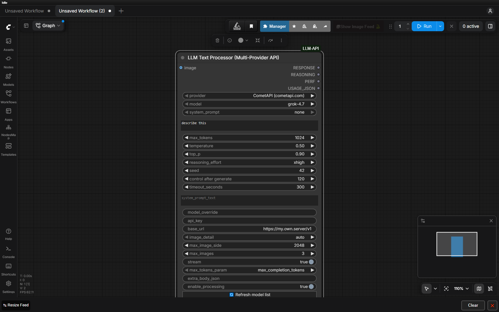

# ComfyUI LLM API (Multi-Provider)

One ComfyUI node that talks to **any OpenAI-compatible LLM gateway**. Pick the
provider from a dropdown — the model list and the reasoning levels follow it
automatically.

Originally built as the Grokified-specific node, generalised so the same
workflow can run on **CometAPI**, **Grokified**, or a **local server** without
rewiring anything.

```
provider ▾  CometAPI (cometapi.com)
model    ▾  grok-4.7
```



The status line under the widgets always shows which gateway is active, how many
chat models it advertises, and which environment variable the key is read from.

---

## Why

`ComfyUI-LLM-text-processor` runs a local llama.cpp model.
`ComfyUI-Grokified-API` talks to one cloud gateway.
This pack keeps the same four outputs but lets you switch gateways per node, so
you can A/B two providers, fall back when one account runs dry, or point at a
self-hosted server — with no workflow changes.

---

## Install

```bash
cd ComfyUI/custom_nodes
git clone https://github.com/CraftBlack/ComfyUI-LLM-API.git
```

Restart ComfyUI (or hit **R** in the browser to reload the frontend), then look
under **LLM/API** → *LLM Text Processor (Multi-Provider API)*.

`requirements.txt` lists `requests`, `Pillow` and `numpy` — all three already
ship with ComfyUI, so there is normally nothing to install.

---

## API keys

A key is resolved in this order:

1. the node's **`api_key`** widget (advanced),
2. the provider's **environment variable**.

| Provider | Environment variable | Where to get one |
|---|---|---|
| CometAPI | `COMETAPI_API_KEY` | <https://cometapi.com> → API keys |
| Grokified | `GROKIFIED_API_KEY` | <https://grokified.com> |
| Custom | `LLM_API_KEY` | optional; local servers usually need none |

Windows (persists for the user account):

```powershell
[Environment]::SetEnvironmentVariable("COMETAPI_API_KEY", "sk-...", "User")
```

Linux / macOS / WSL:

```bash
echo 'export COMETAPI_API_KEY=sk-...' >> ~/.bashrc && source ~/.bashrc
```

**Restart ComfyUI afterwards** — a running process keeps the environment it was
started with. Prefer the widget if you would rather not restart, but note that
widget values are stored in the workflow `.json` in plain text.

---

## Nodes

| Node | What it does |
|---|---|
| **LLM Text Processor (Multi-Provider API)** | Calls `/chat/completions` and returns the answer, the reasoning trace, a perf line and raw usage JSON. Optional `IMAGE` input for vision models. |
| **LLM API Model List** | Calls `GET /models` on the selected provider and returns the chat-capable model ids, one per line. Handy for discovering what a gateway offers today. |

Outputs of the main node deliberately match `ComfyUI-LLM-text-processor` and
`ComfyUI-Grokified-API`:

| # | Name | Contents |
|---|---|---|
| 0 | `RESPONSE` | Final answer, reasoning stripped out |
| 1 | `REASONING` | The model's reasoning trace (empty when it exposes none) |
| 2 | `PERF` | e.g. `CometAPI \| grok-4.7 \| 1248 in / 58 out (reasoning 56) \| 2.10s stream` |
| 3 | `USAGE_JSON` | Provider, model, base URL, token counts (incl. `reasoning_tokens` and `reasoning_chars`), latency, notes |

---

## Providers

| | CometAPI | Grokified | Custom |
|---|---|---|---|
| Base URL | `https://api.cometapi.com/v1` | `https://api.grokified.com/v1` | anything |
| Default model | `grok-4.7` | `grok-4.7` | `local-model` |
| Catalogue size | 472 ids, **15** chat-capable | account-dependent | whatever it serves |
| Reasoning levels | `minimal` `low` `medium` `high` `xhigh` `max` | `low` `medium` `high` `xhigh` | all |
| Vision (data-URI images) | yes | yes | depends |
| Streaming | yes | yes | depends |

The node asks `GET /models` for the live list and keeps only the ids a
`/chat/completions` call can actually serve (CometAPI tags them
`supported_endpoint_types: ["openai-chat", ...]`). If the endpoint is
unreachable, a static fallback list is shown and the reason appears in the
node's status line.

---

## Parameters

### Provider & model

| Widget | Notes |
|---|---|
| `provider` | Switching it reloads `model` and `reasoning_effort`. |
| `model` | Live catalogue for the selected provider. |
| `model_override` | Type any id to bypass the dropdown — required for custom endpoints. |
| `base_url` | Empty = the provider's own URL. The frontend fills it in when you switch provider; a value you typed is never overwritten. |
| `api_key` | Empty = the provider's environment variable. |

### Generation

| Widget | Default | Notes |
|---|---|---|
| `prompt` | — | User message. Dynamic prompts supported. |
| `system_prompt` | `none` | Preset from `ComfyUI/models/LLM/prompts` (same folder as the local LLM node). |
| `system_prompt_text` | `""` | Inline system prompt; wins over the preset. |
| `max_tokens` | `4096` | Output cap, sent as `max_completion_tokens`. |
| `temperature` / `top_p` | `0.7` / `0.95` | Sampling. Reasoning models may ignore them. |
| `reasoning_effort` | `high` | `default` omits the field entirely. |
| `seed` | `1` | Sent when > 0. Doubles as ComfyUI's cache key — bump it to force a fresh call. |
| `timeout_seconds` | `300` | Per-request timeout. |

### Images

| Widget | Default | Notes |
|---|---|---|
| `image` | — | `IMAGE` input; a batch sends up to `max_images` frames. |
| `image_detail` | `auto` | Sent only to providers without `supports_detail: false`. |
| `max_image_side` | `2048` | Downscales larger images. `0` disables. |
| `max_images` | `3` | Batch cap. |

Images are inlined as `data:` URIs (PNG while it fits, then JPEG at falling
quality, then progressively scaled down) and stay under 18 MiB.

### Advanced

`stream` (on by default), `max_tokens_param`, `extra_body_json` (merged into the
request body — `{"stop": ["\n\n"]}`), `enable_processing` (off = forward the
prompt to `RESPONSE` without calling the API, for dry runs).

---

## Verified behaviour

Everything below was measured against the live endpoints, not copied from docs.
Reproduce with `tests/probe_*.py`.

<details>
<summary><b>CometAPI</b> — <code>grok-4.7</code>, 2026-11-06</summary>

| Fact | Evidence |
|---|---|
| `grok-4.7` exists | present in the 472-id `/models` response |
| Only 15 of 472 ids are chat models | filtered on `supported_endpoint_types` containing `openai-chat` |
| `reasoning_effort` is honoured | `reasoning_tokens` scaled 166 → 1033 across `low` … `xhigh` |
| `minimal` and `max` are accepted | HTTP 200; Grokified's `grok-4.7` does **not** accept these |
| `none` / `disabled` are rejected | HTTP 400 `This model does not support reasoning_effort value none.` |
| the bare word `default` is rejected | HTTP 400 `{"code":"invalid-argument","error":"Invalid reasoning effort."}` — so the node strips it instead of sending it |
| **`max_tokens` is ignored** | `max_tokens: 40` produced **3426** completion tokens |
| `max_completion_tokens` is exact | `max_completion_tokens: 80` produced exactly 80 and `finish_reason: length` |
| vision works with data URIs | a 64×64 red PNG returned `Red` |
| streaming works | 15 SSE chunks, `[DONE]` sentinel, usage in the final chunk |
| reasoning **is** streamed as `delta.reasoning_content` | confirmed on several calls |
| **the trace is exposed only intermittently** | measured over 15 calls: `reasoning_tokens = 2919` with **0** characters of `reasoning_content`, on streaming *and* non-streaming alike — see below |
| unknown model = **HTTP 503** | `{"code":"model_not_found","message":"no available channel for group default and model ..."}` — classified as fatal so it is not retried 4× |
| bad key = HTTP 401 | `{"code":"","message":"invalid token (request id: ...)"}` |

</details>

### The reasoning trace is not guaranteed

Both transports were measured side by side with the same prompt:

| call | `reasoning_tokens` | `REASONING` characters |
|---|---|---|
| non-streaming | 294 | 128 |
| streaming | 2288 | **0** |
| non-streaming | 941 | **0** |
| streaming | 1069 | **0** |
| non-streaming | 369 | 102 |
| streaming | 327 | 123 |

There is no pattern to it — the gateway simply returns the trace for some calls
and withholds it for others. It is not a streaming problem, and there is nothing
a client can do about it.

So the node reports it rather than leaving you guessing. When the gateway bills
reasoning tokens but sends no text, `USAGE_JSON` gains:

```json
{
  "reasoning_tokens": 3205,
  "reasoning_chars": 0,
  "notes": ["the gateway reported 3205 reasoning tokens but exposed no reasoning text for this call"]
}
```

and the same line is written to the ComfyUI console. `REASONING` is always
exactly what the gateway sent — never synthesised, never re-requested.

<details>
<summary><b>Grokified</b></summary>

| Fact | Evidence |
|---|---|
| Reasoning levels are `low/medium/high/xhigh` | <https://grokified.com/docs/reasoning> — there is no `none` |
| Vision takes `image_url` data URIs, ≤ 20 MiB, jpg/png | <https://grokified.com/docs/vision> |
| An unfunded account answers **HTTP 402** | `Grokified is for paying customers. Top up ($5 minimum) ...` — surfaced verbatim, never retried |

</details>

---

## Troubleshooting

| Symptom | Cause / fix |
|---|---|
| `No API key for ...` | Set the environment variable **and restart ComfyUI**, or paste the key into `api_key`. |
| `HTTP 402` | The account has no credit. Top up, or switch the `provider` dropdown. |
| `HTTP 401 invalid token` | Wrong or revoked key for that provider. |
| `model_not_found` (HTTP 503) | The id is not a chat model on that gateway. Use **LLM API Model List** to see the real list. |
| Model dropdown looks stale | Press **🔄 Refresh model list** on the node. |
| Dropdown is empty / status shows `⚠` | `/comfyui_llm_api/models` could not reach the gateway; the static fallback list is shown and the reason is printed in the node. |
| Output cut off | Raise `max_tokens`; the console logs a warning when `finish_reason` is `length`. |
| `REASONING` is empty but tokens were billed | The gateway withheld the trace — see [above](#the-reasoning-trace-is-not-guaranteed). `USAGE_JSON` says so in `notes`. |
| Config changed but nothing happened | ComfyUI caches by input values — bump `seed`. |

---

## How it works

```
providers.py       provider registry (URLs, key env vars, capability flags)
llm_api_client.py  requests-based /chat/completions client, retries, auto-downgrade
images.py          IMAGE tensor -> inline image_url parts
prompts.py         ComfyUI/models/LLM/prompts presets
nodes.py           the two nodes
routes.py          /comfyui_llm_api/providers and /comfyui_llm_api/models
web/js/llm_api.js  narrows the combos when `provider` changes
tests/             offline unit suite, live node suite, browser suite, live probes
```

ComfyUI calls `INPUT_TYPES()` once, so the server bakes the **union** of every
provider's models and reasoning levels into the combos. The frontend then
narrows them per provider and pulls the live catalogue over
`/comfyui_llm_api/models`. `VALIDATE_INPUTS` accepts anything, so a value the
server's static list does not know about still runs.

Both route paths are namespaced under `/comfyui_llm_api/` — ComfyUI aborts a
pack when two custom nodes register the same route, and generic names like
`/models` are already taken.

---

## Tests

Three suites, all green on ComfyUI 0.43.0 / frontend 1.57.6.

```bash
python tests/self_test.py            # 226 checks - offline, no network, no ComfyUI

COMETAPI_API_KEY=sk-... python tests/probe_cometapi.py     # live capability probe
COMETAPI_API_KEY=sk-... python tests/probe_calibrate.py    # effort scaling, both gateways
COMETAPI_API_KEY=sk-... python tests/probe_reasoning_stream.py   # trace / transport matrix

# 49 checks - queues real prompts through a running ComfyUI
COMFY_URL=http://127.0.0.1:8188 python tests/live_node_test.py

# 54 checks - drives a real browser against a running ComfyUI
COMFY_URL=http://127.0.0.1:8188 node tests/browser/live_test.js
```

**`tests/self_test.py`** loads the pack the way ComfyUI does and covers the
request bodies, the SSE parser, the error classifier, the image pipeline and the
node contract. It also fails if an API key is ever committed.

**`tests/live_node_test.py`** builds real prompts, queues them through
`POST /prompt` and reads `GET /history/<id>` back. It covers text, streaming,
vision through `LoadImage`, the model-list node, a bad model id, a bad key, an
unfunded Grokified account and `enable_processing = false`.

**`tests/browser/live_test.js`** is the only thing that can prove the frontend
half works: it loads ComfyUI in Chromium, injects a workflow whose saved
provider is *Grokified* (while the server-side default is *CometAPI*), and
asserts the combos really are re-narrowed, that switching provider pulls the
live catalogue, and that a hand-typed `base_url` is never overwritten.

---

## License

MIT — see [LICENSE](LICENSE).
